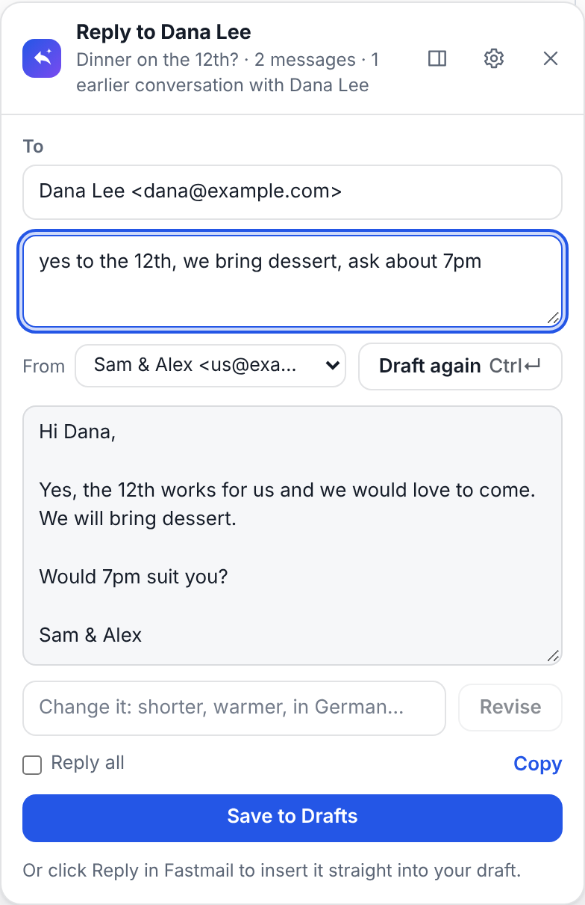
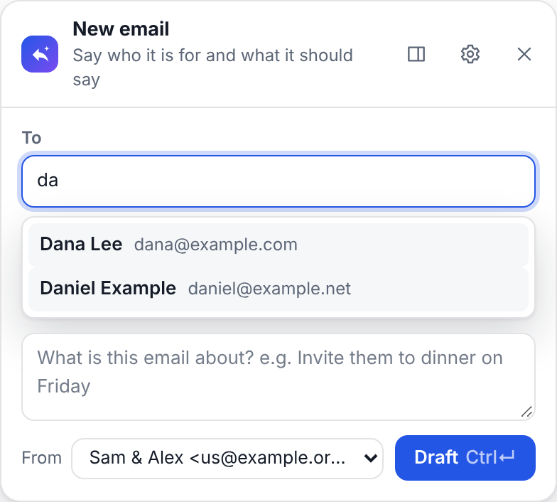

# Fastmail Assist

[](https://github.com/jarofclay/fastmail-assist/actions/workflows/ci.yml)
[](https://github.com/jarofclay/fastmail-assist/releases/latest)
[](LICENSE)

A browser extension for [Fastmail](https://www.fastmail.com)'s web app, for Chrome and Firefox. Say in one line what an email should say, and get a draft in your own voice that already knows the whole conversation and who you are writing to. The draft lands in the Fastmail draft you have open, or in your Drafts folder. You review and send it in Fastmail. The extension cannot send mail.

It brings the one feature worth keeping from AI-assisted mail clients to Fastmail, without leaving the Fastmail tab, and runs entirely in your browser with your own Fastmail API token and Claude API key. No server, no account, nothing collected.

<p>
  
  
</p>

## What it does

- **Reply with AI** sits next to Fastmail's own Reply button, as a floating button, and in the corner of any open draft editor. It opens a small composer in the page. Type the instruction ("yes to the 12th, ask if they can host"), press Draft, and the reply streams in.
- **It reads the whole conversation**, not just the last message: every message in the thread, who took part, and what has already been agreed. Quoted repeats are stripped so the model sees each message once.
- **It knows the person.** Before drafting, it looks up recent earlier conversations with the recipient and gives the model the latest message of each as background, so the greeting uses the right name and the draft fits the relationship. The composer says how many it found. This can be turned off in the settings.
- **New emails** get a To field that suggests people from your Fastmail contacts and from recent correspondence as you type. Any address can be typed in. The model suggests a subject, which you can edit.
- **Drafts sound like you.** Each sending identity has its own voice notes, and the identity the conversation was addressed to is picked for you.
- **Edit or revise.** Change the text directly, or ask for a revision ("shorter", "warmer", "in German").
- **Finish in Fastmail.** Insert into the open draft, where Fastmail handles recipients, the quoted original and your signature, or Save to Drafts, threaded onto the conversation. Either way you send it yourself.
- **Side panel** (Chrome) or **sidebar** (Firefox), with the same flow, a list of recent conversations, and a full new-email form.

## Privacy and security

- **It cannot send.** The extension asks Fastmail only for the `core`, `mail` and (optionally) `contacts` JMAP capabilities and never calls anything that sends. Create the API token without the "Email submission" scope and this holds even if the code were wrong. Tests assert it over every source file and every request made in the browser test.
- **Your keys stay in your browser profile** and are sent only to `api.fastmail.com` and `api.anthropic.com`. Those two plus `app.fastmail.com` are the extension's only host permissions.
- **What leaves the browser:** the open conversation, the earlier conversations with the recipient (if that setting is on), and your instruction go to the Claude API under your own API account. Nothing goes anywhere else. There is no server of ours and no analytics.
- **Email text is treated as untrusted input.** It is fenced in the prompt and the model is told to treat it as material, never as instructions.
- **Correspondents' mail goes to the model.** That is the same as using any AI connector on your mailbox, but it is a decision to make knowingly, especially for a shared or organisational inbox.

[DESIGN.md](DESIGN.md) has the full architecture, the security model, open questions and milestones; [AGENTS.md](AGENTS.md) has the current state and what to do next.

## Install

### From a release

Download the zip for your browser from the [latest release](https://github.com/jarofclay/fastmail-assist/releases/latest).

**Chrome** (and other Chromium browsers): unzip it, open `chrome://extensions`, turn on **Developer mode**, click **Load unpacked** and choose the unzipped folder.

**Firefox** (140 or newer): open `about:debugging#/runtime/this-firefox`, click **Load Temporary Add-on…** and choose the zip. A temporary add-on goes away when Firefox restarts; for a permanent install, sign the zip as an unlisted add-on at [addons.mozilla.org](https://addons.mozilla.org/developers/) and install the signed file.

### From source

Requires Node 20 or newer.

```sh
npm install        # also installs the pre-push secret scan
npm run build      # outputs dist/chrome and dist/firefox
```

Then load `dist/chrome` as an unpacked extension, or `dist/firefox/manifest.json` as a temporary add-on, as above. After a rebuild, press the reload icon on the extension card and reload the Fastmail tab.

## Set up

Open the extension's settings and add:

1. **A Fastmail API token.** In Fastmail: Settings → Privacy & Security → Manage API tokens → New API token. Tick **Email**. Tick **Contacts and contact groups** too if you want the To field to suggest people from your address book. Leave **Email submission** unticked. (API tokens are not available on Fastmail's Basic plan.)
2. **A Claude API key** from [console.anthropic.com](https://console.anthropic.com/). The default model is `claude-sonnet-5-5`; any model id can be typed in. An organisation with zero data retention enabled cannot use a key directly from a browser; see DESIGN.md for the alternative.
3. **One identity per address you write from**, with a few voice notes each ("Warm and brief. First names. Signs off with both our names.").

Use both **Test connection** buttons. The Fastmail one also says whether contacts are readable. Then open a conversation at app.fastmail.com.

## Use

| Where | How |
| --- | --- |
| Inside Fastmail | **Reply with AI** next to Reply, the floating button bottom right, or **Alt+Shift+D**. With a draft open, the reply-arrow button in the editor's corner opens the composer too, and the composer offers **Insert into draft**. |
| Side panel / sidebar | **Alt+Shift+R**, or the toolbar icon. Picks up the conversation open in the tab, or lists recent ones. In Chrome the panel belongs to Fastmail tabs: it does not follow you into other tabs, and the icon or shortcut on another tab brings you to Fastmail. |
| Shortcuts in the composer | **Ctrl/⌘+Enter** drafts, **Enter** in the revision box revises, **Esc** closes. Nothing you type reaches Fastmail's own shortcuts. |

The "Reply with AI" toolbar button and the editor chip depend on Fastmail's page markup and can each be switched off in the settings; the floating button and Save to Drafts work without touching the page.

## Development

```sh
npm run check      # secret scan, typecheck, unit tests, production build; run before every commit
npm test           # unit tests only (vitest)
npm run e2e        # browser test: the built extension in Chromium against a stand-in for Fastmail and the Claude API
npm run dev        # rebuild both targets on change
npm run package    # check, then zip both builds into dist/
npm run scan       # the secret scan alone
```

`npm run e2e` needs Playwright with Chromium on the machine (`npm install --no-save playwright && npx playwright install chromium`); it is not a dependency of the project and never touches a real account. On Linux without a display, run it under `xvfb-run -a`. Set `FA_SHOTS=some/dir` to get screenshots; the ones in `docs/` come from there, which is why they show a stand-in page rather than real mail.

**Before pushing:** `npm run scan` looks for keys, tokens and real email addresses in the working tree. The pre-push hook runs the same scan over every commit about to be pushed and refuses the push if it finds anything. Tests and fixtures use `example.org` addresses only.

### Layout

```
scripts/build.mjs           builds dist/chrome and dist/firefox
scripts/manifest.mjs        the manifest for each browser
scripts/scan-secrets.mjs    secret scan (npm run scan, pre-push hook)
scripts/release.mjs         tags a release after the checks (npm run release)
scripts/release-notes.mjs   release notes from CHANGELOG.md, used by the release workflow
src/content.ts              everything shown inside the Fastmail page
src/background.ts           mail and model work for the in-page composer; opens the panel
src/sidepanel/              side panel / sidebar (Vue)
src/options/                settings page (Vue)
src/lib/                    JMAP client, Claude client, reply and prompt logic
tests/                      unit tests, and tests/e2e for the browser test
.github/workflows/          CI on pull requests; releases from tags
```

### Releasing

1. Bump the version: `npm version 0.4.0 --no-git-tag-version`, and add a `## [0.4.0] - <date>` section to `CHANGELOG.md`.
2. Commit, then `npm run release`. It checks that the tree is clean and the version is consistent, runs `npm run check`, and creates the tag `v0.4.0`.
3. `git push origin v0.4.0`. The Release workflow builds both extensions, zips them and publishes a GitHub release with the zips attached and the changelog section as notes.

## Status

Version 0.3.1 builds for both browsers and passes the unit tests and the browser test. It has not yet been run against a real Fastmail account or the real Claude API; that is milestone M1 in [DESIGN.md](DESIGN.md), which also lists what is still unverified about Fastmail's real page.

## License

[MIT](LICENSE). Fastmail Assist is an independent project, not affiliated with Fastmail or Anthropic.
